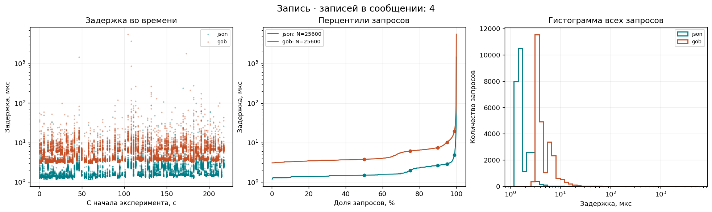
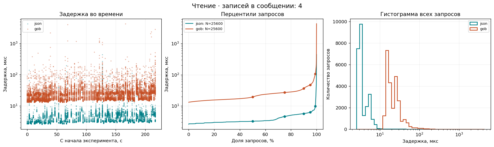
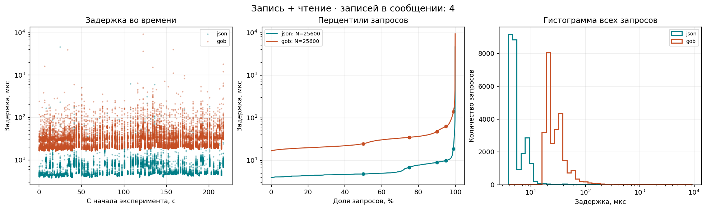
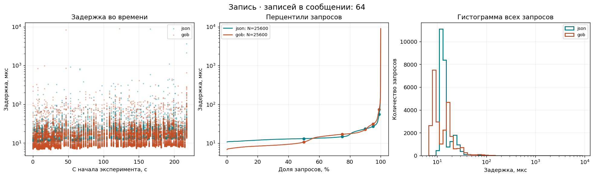
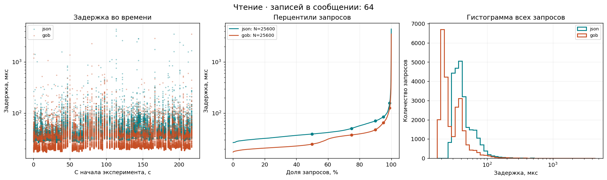
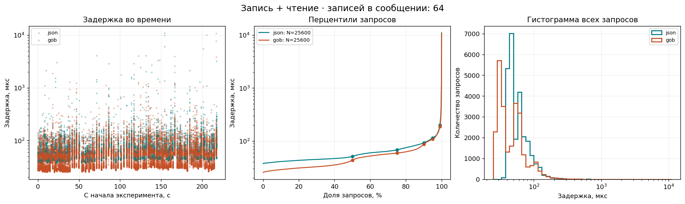

# Результаты полного эксперимента

Дата UTC: 20261105T153029Z. Идентификатор: `20261105t153029z-7865e4d7`.

**100 отдельных образов, 100 новых контейнеров, 12 комбинаций, 1,228,800 логических операций.**
На каждую комбинацию приходится 100 испытаний и 25 600 индивидуальных задержек.

Откройте [report.html](report.html) локально в браузере. Все рисунки встроены в HTML.

Окружение: go1.27.3, linux/amd64, Docker 29.8.2, WSL/Docker Desktop, CPU 0.
Полное время с Docker и очисткой: 220.57 с; сумма времени бенчмарков: 35.20 с.

## Сравнение

Медиана **парного** отношения пакетного времени gob/JSON; >1 — gob медленнее.

| Записей | Сценарий | gob/JSON | 95% bootstrap CI |
|---:|---|---:|---|
| 4 | write | 2.570 | [2.472; 2.753] |
| 4 | read | 7.508 | [7.198; 7.820] |
| 4 | roundtrip | 5.948 | [5.657; 6.096] |
| 64 | write | 1.142 | [1.095; 1.187] |
| 64 | read | 0.842 | [0.813; 0.882] |
| 64 | roundtrip | 0.730 | [0.698; 0.782] |

Результат зависит от размера сообщения и операции. Универсального победителя из этого сравнения выводить нельзя: каждый gob-поток здесь создаётся заново и содержит описание типов.

## Измерительный инструмент

Медиана пакетного overhead: 2.165 нс/оп; p99 по испытаниям: 3.351 нс/оп. Испытаний выше желательных 5 нс: 0.
Средний пустой индивидуальный интервал: 39.52 нс; полный цикл таймера и сохранения: 94.37 нс/оп. Минимальный наблюдаемый положительный интервал: 99 нс.
Нулевая медиана короткого таймера обусловлена квантованием; это не нулевая стоимость измерения.
За пределами 100 нс–50 мс: 0 индивидуальных задержек. Выбросы не отбрасывались.

## Фазы

| Фаза | Логических операций |
|---|---:|
| warmup | 307,200 |
| batch | 307,200 |
| requests | 307,200 |
| teardown | 307,200 |

Warmup и teardown не участвуют в основных распределениях. Контрольные пустые вызовы и проверка корректности учтены отдельно в summary.

## Проверка

```bash
cd lab3
python3 scripts/verify.py evidence
```

- `raw.jsonl.gz`: все исходные измерения и времена фаз.
- `manifest.json`: image/container ID, настройки CPU/RAM и SHA-256 бинарника.
- `summary.json`, `statistics.csv`: статистические показатели.
- `SHA256SUMS`: контрольные суммы всех файлов этого каталога.

Проверка пересчитывает статистику из raw и сравнивает её с опубликованной.
Графики на GitHub:













